 

---

##  Sobre mim

- 🎓 Estudante de **Análise e Desenvolvimento de Sistemas**
- 📍 São Paulo, Brasil
- 🎮 Aspirante a **Game Dev** com **C# e Unity**, apaixonado por mundos 2D imersivos
- 🌐 Construo aplicações web com **Next.js, Node.js e Express**
- 🌱 Sempre aprendendo algo novo e colocando em prática nos meus projetos
- ⚡ Curiosidade: comecei a programar com **C** e hoje vivo entre o navegador e a Unity

 

---

## 🛠️ Tecnologias

### Web

### Games & linguagens

### Ferramentas

---

## 🚀 Projetos em destaque

| Projeto | O que é | Tecnologias |
| :-- | :-- | :-- |
| 📝 [**Mural de Notas**](https://github.com/Gustavo01010001/mural-de-notas) | Bloco de notas online com post-its animados, pastas, busca, clima dinâmico, lembretes e trabalho em grupo |    |
| 🎮 [**AEG Game Portfolio**](https://github.com/Gustavo01010001/AEGGamePortfolio) | Portfólio dos meus projetos de games |   |
| 💈 [**Barbearia**](https://github.com/Gustavo01010001/Barbearia) · [🔗 ver online](https://barbearia-ten-omega.vercel.app) | Landing, agendamento com checagem de horário em tempo real e painel admin |    |
| 🧁 [**Doceria da Raissa**](https://github.com/Gustavo01010001/Doceria-da-Raissa) | Sistema web para uma doceria |   |
| 🃏 [**21 Blackjack**](https://github.com/Gustavo01010001/FIPP21--Winx) | Jogo de 21 em equipe |   |
| 💌 [**Parabéns, pai!**](https://github.com/Gustavo01010001/parabens-pai) · [🔗 ver online](https://gustavo01010001.github.io/parabens-pai/) | Carta animada de aniversário |   |

---

## 📊 Estatísticas

### 🐍 A cobrinha que come minhas contribuições

---

### 💜 Obrigado pela visita!

